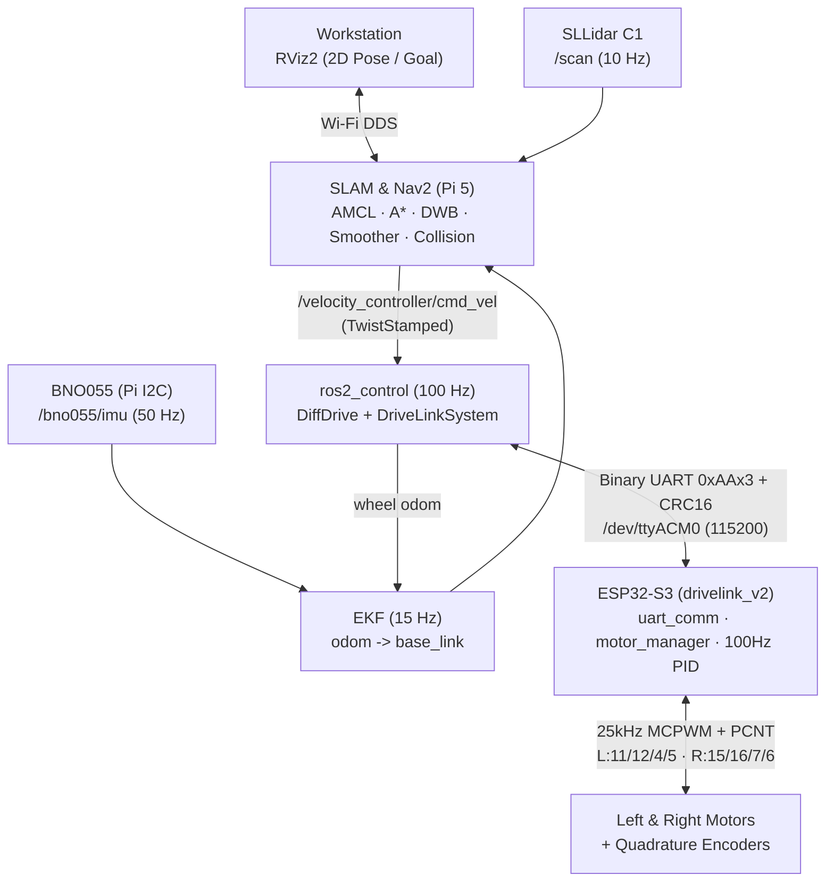

# Riggu (`riggu_ws_v2`)

**Riggu** is a ROS 2 Jazzy autonomous differential-drive mobile robot built on a **Raspberry Pi 5** and an **ESP32-S3** real-time motor controller (`drivelink_v2`), equipped with a **Slamtec SLLidar C1** 2D LiDAR and a **Bosch BNO055** 9-DOF IMU.

---

## Features

- **Closed-Loop Motor Control (`ros2_control` + ESP32-S3):** Custom C++ hardware interface (`drivelink_hardware`) communicating over framed binary UART with hardware quadrature encoder feedback and onboard ESP-IDF PID control.
- **Sensor Fusion (`robot_localization`):** EKF fuses wheel odometry and 50 Hz BNO055 IMU data (`odom -> base_link`) for smooth pose tracking.
- **2D SLAM Mapping (`slam_toolbox`):** Live room mapping from 2D laser scans with map export (`map_saver_cli`).
- **Autonomous Navigation (`nav2`):** AMCL localization on saved maps, global A* path planning (`NavfnPlanner`), local obstacle avoidance (`DWBLocalPlanner`), velocity smoothing, and LiDAR-based collision stopping.
- **Remote Monitoring & Control:** Headless robot bringup on Raspberry Pi 5 paired with remote RViz2 visualization and goal commanding over Wi-Fi.

---

## System Architecture



---

## Repository Structure

```text
riggu_ws_v2/
├── src/
│   ├── drivelink_hardware/    # ros2_control hardware plugins & UART protocol client
│   ├── drivelink_bringup/     # URDF, controller, EKF, SLAM, Nav2 configs & launch files
│   └── sllidar_ros2/          # (Optional/external) Slamtec SLLidar C1 ROS 2 driver
├── firmware/
│   ├── COLCON_IGNORE          # Keeps colcon from parsing ESP-IDF CMake files
│   └── drivelink_v2/          # ESP32-S3 ESP-IDF / PlatformIO firmware
├── docs/                      # Detailed architecture, setup, commands & troubleshooting guides
├── maps/                      # Saved 2D occupancy maps (.yaml + .pgm)
└── archive/                   # Original ros2_control protocol spec & implementation notes
```

---

## Documentation

Detailed guides for every part of Riggu live in [`docs/`](docs/):

| Guide | What It Covers |
| :--- | :--- |
| [**1. Dependencies & Setup**](docs/01-dependencies-and-setup.md) | Ubuntu 24.04 / ROS 2 Jazzy packages, Pi I2C & serial setup, ESP-IDF/PlatformIO tools, workspace build, and Wi-Fi clock sync |
| [**2. `drivelink_hardware` Overview**](docs/02-drivelink-hardware.md) | `DriveLinkSystem` & `DriveLinkImuSensor` plugins, `DriveLinkComm` binary protocol, real-time loop design, unit tests, and `mock_firmware.py` |
| [**3. `drivelink_bringup` Overview**](docs/03-drivelink-bringup.md) | URDF/Xacro & GPIO pin mapping, `controllers.yaml`, Pi BNO055 I2C node, EKF sensor fusion, SLAM Toolbox, and Nav2 Jazzy pipeline |
| [**4. `drivelink_v2` ESP-IDF Firmware**](docs/04-firmware-drivelink-v2.md) | ESP32-S3 firmware components (`uart_comm`, `motor_hal`, `rotary_encoder_hal`, `pid`, `motor_manager`, `imu_bmo_055`, `time_sync`) and flashing |
| [**5. Running the Bot**](docs/05-running-the-bot.md) | Exact step-by-step commands for base bringup, straight-drive motor tests, SLAM mapping, autonomous Nav2 navigation, and RViz2 |
| [**6. Errors & Fixes Log**](docs/06-troubleshooting-and-fixes.md) | Every major ROS 2 Jazzy, Nav2, `ros2_control`, ESP32, and Raspberry Pi 5 issue encountered on Riggu and how it was solved |
