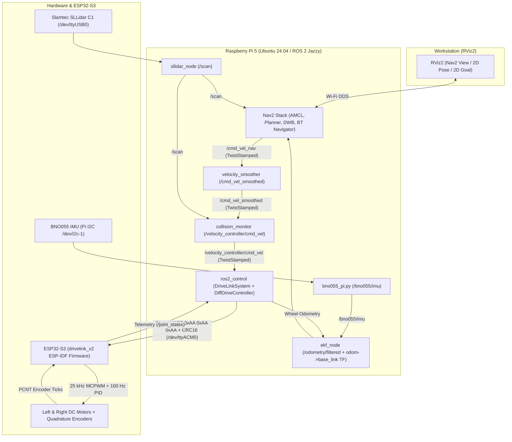

# Riggu (`riggu_ws_v2`)

**Riggu** is a differential-drive autonomous mobile robot built on **ROS 2 Jazzy**, a **Raspberry Pi 5** (Ubuntu 24.04 LTS), an **ESP32-S3** motor controller running custom **ESP-IDF (`drivelink_v2`)** firmware, a **Slamtec SLLidar C1**, and a **Bosch BNO055** 9-DOF IMU.

It supports closed-loop `ros2_control` drive, EKF sensor fusion (`robot_localization`), 2D mapping (`slam_toolbox`), and autonomous navigation (`nav2`).

---

## System Architecture



---

## Repository Structure

```text
riggu_ws_v2/
├── src/
│   ├── drivelink_hardware/       # ros2_control SystemInterface & SensorInterface C++ plugins + CRC16 UART comm
│   ├── drivelink_bringup/        # URDF/xacro, controllers, EKF, SLAM, Nav2 configs & launch files
│   └── sllidar_ros2/             # Slamtec SLLidar C1 driver (or installed/managed externally)
├── firmware/
│   ├── COLCON_IGNORE             # Prevents colcon from building ESP-IDF files as ROS packages
│   └── drivelink_v2/             # ESP32-S3 ESP-IDF / PlatformIO firmware (see firmware section below)
├── maps/                         # Saved 2D occupancy grid maps (.yaml + .pgm)
├── archive/                      # Original ros2_control protocol & implementation design logs
└── README.md
```

---

## Hardware & Pinout

### Compute & Peripherals

| Component | Interface / Port | Notes |
| :--- | :--- | :--- |
| **Raspberry Pi 5** | Ubuntu 24.04 LTS (`6.8.0-raspi`) | Runs `ros2_control`, EKF, SLAM Toolbox, Nav2 |
| **ESP32-S3-DevKitC-1** | USB Serial `/dev/ttyACM0` (`115200` baud) | Runs `drivelink_v2`; `uart_comm` on UART0 (TX `GPIO 43`, RX `GPIO 44`), console on `USB_SERIAL_JTAG` |
| **Slamtec SLLidar C1** | USB Serial `/dev/ttyUSB0` | 10 Hz scan rate, 5 kHz sample rate, topic `/scan`, frame `laser` |
| **Bosch BNO055 IMU** | Pi I2C `/dev/i2c-1` (`GPIO 2` SDA, `GPIO 3` SCL) | Managed on Pi by `bno055_pi.py` in NDOF mode (`0x0C`) at 50 Hz, topic `/bno055/imu` |

### Motor & Encoder Wiring (ESP32-S3 GPIOs)

Pin assignments are configured dynamically at startup from `src/drivelink_bringup/urdf/robot.urdf.xacro` via the `CREATE_MOTOR` (`0x21`) UART command:

| Motor | PWM GPIO | DIR GPIO | Encoder A | Encoder B |
| :--- | :---: | :---: | :---: | :---: |
| **Left Motor (`motor_id=1`)** | `GPIO 11` | `GPIO 12` | `GPIO 4` | `GPIO 5` |
| **Right Motor (`motor_id=2`)** | `GPIO 15` | `GPIO 16` | `GPIO 7` | `GPIO 6` |

* **Power & Ground:** Motor driver `GND` and encoder `GND` must share common `GND` with the ESP32-S3. Encoder `VCC` connects to `3.3V` (or `5V` depending on encoder rating).
* **Legacy ESP32 I2C IMU pins (unused in current Pi-I2C setup):** `drivelink_v2` defaults to I2C0 on `GPIO 8` (SDA) and `GPIO 9` (SCL), address `0x28`, mode `0x0C` (`IMUPLUS`). In Riggu, the BNO055 was moved to the Pi's `/dev/i2c-1`, and `<ros2_control name="DriveLinkImuSensor">` in `robot.urdf.xacro` is commented out so only `DriveLinkSystem` owns `/dev/ttyACM0`.

### Coordinate Frames (TF2 Tree)

$$\text{map} \xrightarrow{\text{slam\_toolbox / amcl}} \text{odom} \xrightarrow{\text{ekf\_node}} \text{base\_link} \xrightarrow{\text{robot\_state\_publisher}} \text{laser}$$

* `lidar_mount_joint`: Relocated from the caster end (`x = +0.26`) to `xyz="-0.01 0.0 0.152" rpy="0 0 0"` in `robot.urdf.xacro`.

---

## ESP32-S3 Firmware (`firmware/drivelink_v2`)

`drivelink_v2` is an **ESP-IDF 5.5.2** (also PlatformIO-compatible via `platformio.ini`) C++ firmware project targeting `esp32s3` (`esp32-s3-devkitc-1`, 16 MB QIO flash, 240 MHz CPU, 1000 Hz FreeRTOS tick).

### Firmware Components

| Component | Responsibility |
| :--- | :--- |
| `uart_comm` | Framed binary UART protocol (`0xAA 0xAA 0xAA`, `MSG_TYPE`, `LEN`, payload, little-endian CRC-16/CCITT with `init=0xFFFF`). Supports FIFO commands (`0x01..0x3F`), responses (`0x40..0x7F`), latest-wins streams (`0x80..0xBF`), and events (`0xC0..0xFE`). |
| `motor_hal` | Low-level PWM + DIR motor driver (`esp_motor::Motor`) backed by pooled ESP32-S3 MCPWM timers (`25 kHz` PWM, `1 MHz` timer resolution). |
| `rotary_encoder_hal` | Hardware quadrature decoding using ESP32-S3 PCNT (`1000 ns` glitch filter, `±32767` overflow accumulation). |
| `pid` | Generic discrete PID + feedforward controller (`10 ms` default / `100 Hz`). |
| `motor_controller` | Binds `motor_hal`, `rotary_encoder_hal`, and `pid` per motor (`open_loop`, `velocity`, `position`). |
| `motor_manager` | Orchestrates up to 4 motors over UART (`0x21` configure, `0x61` response, `0x80` setpoint stream, `0x81` telemetry stream). |
| `imu_bmo_055` | BNO055 driver & UART telemetry service (`0x22` configure, `0x42` response, `0x82` stream, `0xC2` events; falls back to mock if hardware absent). |
| `time_sync` | Periodic ESP-initiated clock sync (`0x20` request, `0x60` response) with optional round-trip compensation. |

### Building and Flashing `drivelink_v2`

> Stop `drivelink.launch.py` on the Pi before flashing so `/dev/ttyACM0` is not held by `ros2_control_node`.

#### Option A: ESP-IDF CLI
```bash
source ~/esp/esp-idf/export.sh
cd firmware/drivelink_v2
idf.py set-target esp32s3
idf.py build
idf.py -p /dev/ttyACM0 flash monitor
```

#### Option B: PlatformIO (VS Code / CLI)
```bash
cd firmware/drivelink_v2
pio run -t upload --upload-port /dev/ttyACM0
pio device monitor -b 115200
```

---

## ROS 2 Jazzy Setup & Build (Raspberry Pi 5)

### Prerequisites
```bash
sudo apt update
sudo apt install -y \
  ros-jazzy-ros2-control \
  ros-jazzy-ros2-controllers \
  ros-jazzy-diff-drive-controller \
  ros-jazzy-robot-localization \
  ros-jazzy-slam-toolbox \
  ros-jazzy-navigation2 \
  ros-jazzy-nav2-bringup \
  ros-jazzy-xacro
```

### Build Workspace
```bash
cd ~/riggu_ws_v2
colcon build --symlink-install
source install/setup.bash
```

---

## Running Riggu (Operational Runbook)

### 1. Base Hardware Bringup (Pi — Terminal 1)
Launches `robot_state_publisher`, `ros2_control_node`, `joint_state_broadcaster`, `velocity_controller`, `bno055_pi.py`, and `ekf_node`:
```bash
cd ~/riggu_ws_v2 && source install/setup.bash
ros2 launch drivelink_bringup drivelink.launch.py
```

### 2A. SLAM Mapping Mode (Pi — Terminal 2)
Starts SLLidar C1 and `slam_toolbox` (`online_async_launch.py` with `slam_params_file`):
```bash
cd ~/riggu_ws_v2 && source install/setup.bash
ros2 launch drivelink_bringup slam.launch.py
```
Drive manually using `joystick_teleop`, then save the map once complete:
```bash
ros2 run nav2_map_server map_saver_cli -f ~/riggu_ws_v2/maps/my_new_map
```

### 2B. Autonomous Navigation Mode (Pi — Terminal 2)
Starts SLLidar C1 and Nav2 (`use_composition:=False`):
```bash
cd ~/riggu_ws_v2 && source install/setup.bash
ros2 launch drivelink_bringup navigation.launch.py map:=$HOME/riggu_ws_v2/maps/my_new_map.yaml
```

### 3. Visualization & Goal Control (Laptop — Terminal 3)
On your workstation (same Wi-Fi subnet and matching `ROS_DOMAIN_ID`):
```bash
sudo apt install -y ros-jazzy-nav2-rviz-plugins ros-jazzy-nav2-bringup
source /opt/ros/jazzy/setup.bash
rviz2 -d /opt/ros/jazzy/share/nav2_bringup/rviz/nav2_default_view.rviz
```
1. Click **`2D Pose Estimate`** on the top toolbar, click Riggu's actual position on the map, and drag the green arrow in its heading direction. Wait for AMCL particles and `/scan` red points to align with the walls.
2. Click **`2D Goal Pose`**, click an open target location, and drag the target heading arrow.

---

## Useful Hardware & Topic Diagnostics

| Check | Command |
| :--- | :--- |
| Serial & I2C devices present | `ls -l /dev/ttyACM* /dev/ttyUSB* /dev/i2c*` |
| Grant serial permissions | `sudo chmod 666 /dev/ttyACM* /dev/ttyUSB*` |
| Check wheel encoders | `ros2 topic echo /joint_states` |
| Check fused EKF odometry | `ros2 topic echo /odometry/filtered --field pose.pose.position` |
| Check velocity topic wiring & type | `ros2 topic info -v /velocity_controller/cmd_vel` |
| Direct straight drive test (`TwistStamped`) | `timeout 3 ros2 topic pub -r 10 /velocity_controller/cmd_vel geometry_msgs/msg/TwistStamped "{header: {frame_id: 'base_link'}, twist: {linear: {x: 0.15}, angular: {z: 0.0}}}"` |

---

## Key Issues & Fixes Discovered on Riggu (Reference Notes)

1. **Nav2 Jazzy `Twist` vs `TwistStamped` Mismatch (Bot Not Moving):**
   `diff_drive_controller` in Jazzy subscribes to `geometry_msgs/msg/TwistStamped` on `/velocity_controller/cmd_vel`, while Nav2 defaults to unstamped `Twist` (`enable_stamped_cmd_vel: false`).
   **Fix:** Set `enable_stamped_cmd_vel: true` across `bt_navigator`, `controller_server`, `behavior_server`, `velocity_smoother`, `collision_monitor`, and `docking_server` in `nav2_params.yaml`.

2. **Nav2 Jazzy `collision_monitor` Listening to Wrong Topic:**
   In Jazzy's `nav2_bringup`, `controller_server` outputs `cmd_vel_nav` and `velocity_smoother` outputs **`cmd_vel_smoothed`** (not `cmd_vel`).
   **Fix:** Set `cmd_vel_in_topic: "cmd_vel_smoothed"` and `cmd_vel_out_topic: "/velocity_controller/cmd_vel"` under `collision_monitor` in `nav2_params.yaml`.

3. **Nav2 Jazzy Missing `collision_monitor` & `docking_server` Configs:**
   `nav2_bringup` in Jazzy automatically launches and configures both nodes; omitting their parameter blocks aborts bringup (`observation_sources is not initialized` / `Charging dock plugins not given!`). Both blocks must be present in `nav2_params.yaml`.

4. **Pi 5 Nav2 4000 ms Bond Timeout & Container `SIGSEGV` (`Magick: abort due to signal 11`):**
   Default `use_composition: True` puts all Nav2 nodes inside `component_container_isolated`, and a 4-second `bond_timeout` can trip under Pi startup CPU load.
   **Fix:** Pass `'use_composition': 'False'` in `navigation.launch.py`, and set `bond_timeout: 0.0` in `lifecycle_manager_localization` and `lifecycle_manager_navigation`.

5. **Dual `/dev/ttyACM0` Contention (`ros2_control_node` `exit code -6`):**
   Enabling both `DriveLinkSystem` and `DriveLinkImuSensor` in `robot.urdf.xacro` while using Pi-side `bno055_pi.py` triggers `SIGABRT` during `set_initial_hardware_components_state()`. Keep `DriveLinkImuSensor` commented out when using Pi I2C.

6. **ESP32 `Firmware NACK for SetMode (result=0x02)`:**
   Triggered when the ESP32 watchdog/safety lock trips after sudden serial loss or motor power brownout. Press `EN`/`RST` on the ESP32, confirm motor power is ON, and relaunch `drivelink.launch.py`.

7. **`slam_toolbox` Ignoring Custom Config (`base_footprint does not exist`):**
   `slam_toolbox/launch/online_async_launch.py` requires `slam_params_file:=...` (not `params_file:=...`).

8. **EKF Extrapolation & Clock Drift Errors:**
   * Lower `ekf_filter_node` frequency to `15.0` Hz and add `predict_to_current_time: true` + `transform_time_offset: 0.05` in `ekf.yaml`.
   * Keep Raspberry Pi and Laptop system clocks synchronized (via NTP/Wi-Fi or `date -s`) so RViz and Nav2 do not drop TF frames.

9. **Raspberry Pi 5 Ubuntu 24.04 Lost `/dev/i2c-1` & USB Ports (`brcm-pcie`):**
   Never replace `/boot/firmware/bcm2712-rpi-5-b.dtb` with Raspberry Pi OS firmware on Ubuntu 24.04; the RP1 PCIe southbridge (all USB + I2C) requires the DTB matching `/usr/lib/firmware/<kernel>-raspi/device-tree/broadcom/bcm2712-rpi-5-b.dtb`.
